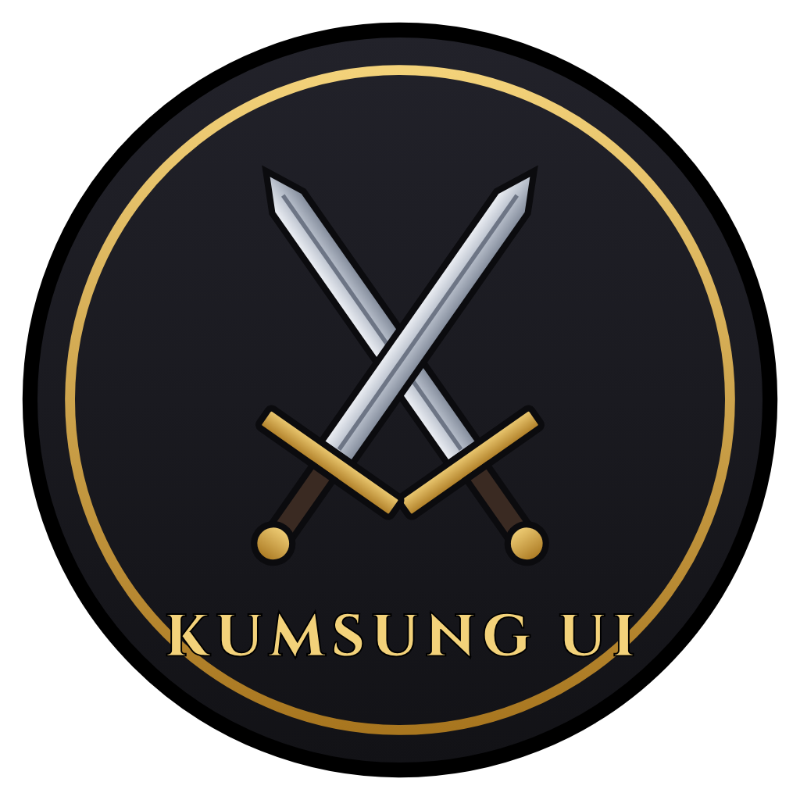
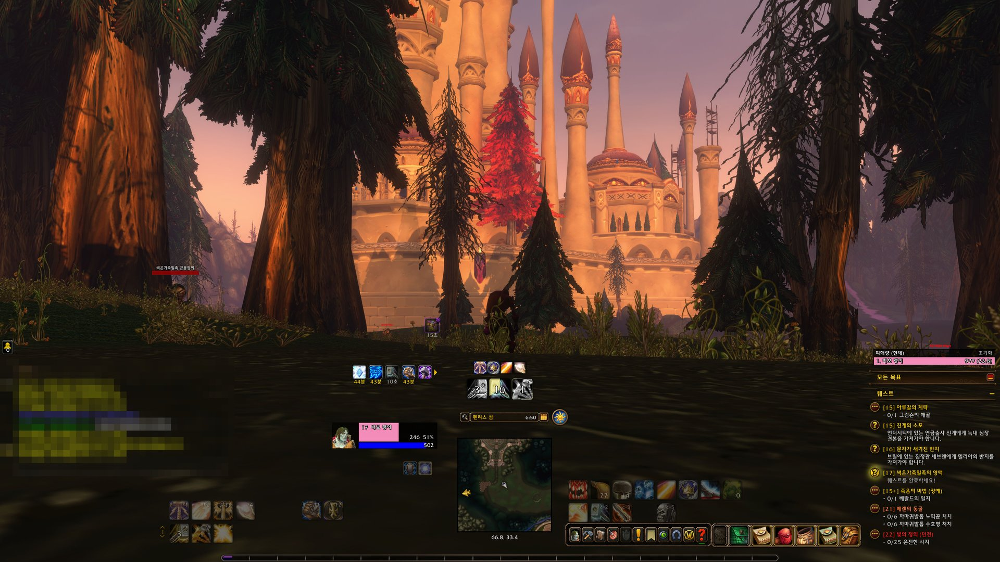

<p align="center"></p>

# 검성UI (Kumsung UI)



WoW Forever(게임 1.60.1, 인터페이스 16001)에서 쓰는 오픈소스 UI 애드온입니다.

기본 UI가 좀 밋밋해서 만들었습니다. 유닛 프레임과 단축바를 어둡게 다시 칠하고, 내 체력바와 대상 체력바는 직업색으로 바꾸고,
단축바에는 쿨다운 숫자를 띄웁니다. 화면 배치는 파티·공격대만 위에 두고 나머지는 전부 아래로 모읍니다.

공격대·우두머리 프레임은 블리자드 것을 그대로 씁니다. 색과 위치만 손대기 때문에 인던이나 레이드의
전투 제한에 걸려도 문제없이 돌아갑니다. 내·대상·주시·파티 프레임은 블리자드 프레임 위에 따로 그리지만, 클릭과 메뉴,
대상 버프, 위협 수치는 밑에 깔린 블리자드 프레임이 그대로 처리합니다.

## 기능

전부 설정에서 하나씩 켜고 끌 수 있습니다.

- **사거리 표시:** 대상이 사거리 밖이면 단축 버튼이 빨개집니다. 마나가 모자랄 때 뜨는 파란색은 그대로 둡니다.
- **체력 %:** 체력·마나바 숫자 옆에 퍼센트가 같이 나옵니다.
- **위협 수치:** 대상 프레임에 위협 수치가 뜹니다. 탱킹 중이면 2등과 얼마나 차이 나는지 보여줍니다.
- **차단 보조:** 대상 프레임 바로 옆에 내 차단 스킬 아이콘과 쿨다운이 뜨고, 그 옆으로 대상 시전바가 옵니다. 대상이 끊을 수 있는 주문을 시전하면 아이콘 테두리가 노랗게 켜집니다. 차단 스킬은 단축바에 올려둔 것 중에서 게임이 차단기로 표시한 것을 알아서 찾습니다. 성기사는 차단기를 배우기 전까지 심판의 망치(기절)를 대신 보여줍니다.
- **해제 가능한 디버프만 (선택):** 켜면 공격대 프레임에 내가 지울 수 있는 디버프만 보여줍니다. 사제의 약화된 영혼처럼
  아무도 못 지우는 디버프도 중요해서 기본은 꺼져 있습니다.
- **쿨다운 관리자:** 블리자드 쿨다운 관리자를 켜서 직업·전문화별 주요 쿨다운과 버프를 띄웁니다. 레벨이 올라 새 스킬을 배우면 알아서 추가됩니다.
  아이콘을 누르면 그 스킬을 씁니다. 전투 중 아이콘이 바뀌면 전투가 끝난 뒤에 맞춥니다.
- **단축바 흐리게:** 전투 중도 아니고 대상도 없으면 단축바가 흐려집니다. 얼마나 흐려질지는 정할 수 있습니다.
- **잡템 판매·자동 수리:** 상인 창을 열면 회색 템은 팔고 장비는 내 돈으로 수리합니다.
- **준비 확인 버프 체크:** 준비 확인이 뜨면 파티·공격대 전원을 보고, 사제·드루이드·마법사 버프가 빠진 사람을 버프별로
  채팅에 알려줍니다.
- **장비 추천:** 가방에 지금 입은 것보다 10% 넘게 좋은 템이 생기면 채팅으로 알려줍니다. 역할은 특성 창에서 포인트를 가장 많이 찍은 트리로 정하고(야성 드루이드는 곰이면 탱커), 설정의
  `장비 추천 기준`으로 직접 고를 수도 있습니다. 캐릭터 창 아래 `추천 장비 착용` 버튼을 누르면 바로 입습니다.
  점수는 전문화 역할(탱커, 힐러, 근접, 캐스터)에 맞춘 대략적인 능력치 가중치로 매깁니다. 방어구, 목걸이, 망토, 반지만 비교하고,
  무기·방패·장신구와 아직 귀속되지 않은 템은 직접 고르도록 남겨둡니다. 같은 반지를 두 개 추천하지는 않습니다.
  `/ksui stats`를 치면 입은 장비마다 점수와, 점수에 들어가지 않는 능력치 이름을 채팅으로 보여줍니다.
- **자동 공격 타이머 (선택):** 켜면 Forever에 들어 있는 블리자드 스윙 타이머(주 무기·보조 무기·원거리)를 전투 중에만
  쿨다운 관리자 위에 쌓아 보여줍니다. 지팡이를 든 법사에게는 빈 막대가 뜨기 때문에 기본은 꺼져 있습니다.
- **남은 탄약:** 사냥꾼처럼 탄약을 쓰는 직업이면 내 체력바 왼쪽 아래에 남은 탄약 수를 쓰고, 100개 밑으로 떨어지면 빨갛게 바꿉니다.
- **설정 내보내기·가져오기:** 설정 맨 위 `빠른 실행`의 버튼이나 `/ksui export`, `/ksui import`로 지금 설정을 한 줄 문자열로
  만들거나 붙여넣어 적용합니다. 다른 캐릭터로 옮기거나 친구와 나눌 때 씁니다. 잘못된 값은 걸러냅니다.
- **영어 지원:** 한국어가 아닌 클라이언트에서는 모든 문구가 영어로 나옵니다.
- **네모 유닛 프레임:** 내·대상·주시·파티·소환수·대상의 대상 프레임을 네모난 초상화와 체력·자원바로 바꿉니다. 초상화는 움직이는 3D 모델이고,
  대상이 멀거나 누군지 가려진 경우에는 그림으로 바뀝니다. 바 위 글자는 검은 테두리를 두른 흰 글씨라 어떤 바 색 위에서도 읽힙니다.
  들어올 힐은 체력 뒤에 초록 막대로, 보호막은 그 뒤에 하늘색 막대로 붙고, 체력 숫자 옆에 두 양이 같은 색으로 나옵니다
  (인던에서 수치가 가려지면 막대만).
  대상·주시 대상의 버프와 디버프는 프레임 바로 아래 왼쪽 끝부터 붙습니다. 몹이 나를 노리면 내 프레임 테두리가
  위협 정도에 따라 노랑·주황·빨강으로 빛납니다.
- **납작한 이름표:** 이름표 체력바를 평평한 색에 얇은 검은 테두리로 바꿉니다. 체력바 끝에 난이도 색 레벨(우두머리는 해골)을
  쓰고, 대상으로 잡은 몹은 테두리가 하얘집니다. 인던 안 아군 이름표처럼
  블리자드가 애드온에 막아둔 이름표는 그대로 둡니다.
- **딜미터:** 퀘스트 목록 위에 붙는 딜미터. 블리자드 전투 데이터를 씁니다. 제목 좌클릭으로 피해량·치유량·받은 피해,
  우클릭으로 최근 전투·현재·전체를 고르고, 줄을 누르면 그 사람의 스킬별 내역이 열립니다. `초기화` 버튼이나 `/ksui reset`으로 지웁니다.
- **파티 위협 미터:** 파티일 때 딜미터 위에 대상에 대한 파티원 위협 %를 보여주고, 대상이 때리는 사람을 표시합니다.
- **네모 미니맵:** 미니맵을 네모로 바꾸고 둥근 테두리 대신 얇은 검은 테두리를 두릅니다.
- **채팅:** 줄 앞에 회색 `[시:분]`, 채널 이름은 짧게(`[1. 공개 - 지역]` → `[공개]`), 웹 주소는 눌러서 복사, 귓속말이 오면 알림음.
- **퀘스트 자동 수락·완료:** 퀘스트 창이 열리면 바로 수락하고 완료합니다. Shift를 누르고 말 걸면 건너뛰고, 보상 고르기·회색 퀘스트·반복(일일) 퀘스트·PvP
  확인은 직접 하도록 남겨둡니다.
- **빠른 전리품:** 자동 줍기가 켜져 있으면 시체를 열자마자 전부 줍습니다.
- **툴팁:** 플레이어 이름을 직업색으로, 그 유닛이 노리는 대상을 아래 줄에 보여줍니다.
- **파티 초대 자동 수락:** 친구·배틀넷 친구·길드원의 초대만 받습니다.
- **경험치바 글자:** 남은 경험치, 휴식 경험치, 최근 퀘스트 기준 남은 퀘스트 수를 경험치바 위에 씁니다.
- **영상 넘기기:** 한 번 본 영상과 컷신은 다음부터 넘깁니다.
- **채집 추적:** 배운 채집 기술에 맞춰 미니맵의 약초·광석·물고기 추적을 켭니다.

## 같이 쓰면 좋은 애드온

- **[Questie](https://github.com/Questie/Questie):** 퀘스트 주는 NPC와 목표 위치를 지도·미니맵에 표시합니다. Forever판이 있으며
  `Questie`와 `QuestieDB`를 같이 설치해야 합니다. 검성UI의 퀘스트 길안내 화살표와 함께 쓰면 됩니다.

## 설정

`/ksui`를 치거나 설정 > 애드온 > 검성UI로 들어가면 됩니다. 맨 위 `빠른 실행`에 화면 배치 적용과 UI 다시 불러오기 버튼이 있습니다. 색, 기능 켜고 끄기, 숫자 크기, 프레임 위치를 바꿀 수 있습니다.
외형과 쿨다운 관련 설정은 바꾸는 즉시 적용됩니다.

## 화면 배치

배치는 알아서 적용됩니다. 처음 설치했을 때와 업데이트한 뒤(`KSUI` 레이아웃을 쓰고 있으면)는 접속하며 바로, 위치 설정을
바꾸면 다음 접속이나 `/reload` 때 적용됩니다. 지금 쓰는 편집 모드 레이아웃을 `KSUI`라는 이름으로 복사해서 옮깁니다.
위치는 화면 대비 비율로 저장하므로 해상도나 UI 크기가 달라도 같은 모양이 됩니다. 바로 다시 적용하고 싶으면 설정의
`화면 배치 적용`이나 `/ksui layout`을 쓰면 됩니다(UI를 다시 불러옵니다, 전투 중에는 안 됨).

- **가운데 아래:** 경험치바, 그 위에 미니맵(지역 이름·달력 줄은 미니맵 아래), 그 위에 시전바, 그 위에 쿨다운 관리자, 맨 위에 자동 공격 타이머(켰을 때, 전투 중에만).
- **미니맵 왼쪽:** 주 단축바, 단축바 2, 오른쪽 단축바 1(가로로 눕힘), 태세바(채팅창과 겹치지 않게 미니맵 쪽 끝에). 주 단축바 테두리 장식과 양쪽 끝의 가고일 장식은 숨깁니다.
- **미니맵 오른쪽:** 게임 메뉴와 가방(75%), 단축바 3, 오른쪽 단축바 2(가로로 눕힘), 소환수바.
- 주 단축바와 그 위에 쌓는 단축바들은 빈 칸을 숨깁니다.
- **쿨다운 관리자 왼쪽:** 버프, 그 위에 디버프. 스킬이 늘어 쿨다운 줄이 넓어지면 같이 밀려납니다.
- 채팅창은 유닛 프레임 높이까지 올립니다.
- **오른쪽 아래:** 퀘스트 목록. 툴팁은 그 위, 우두머리 프레임은 그 왼쪽 위.
- **미니맵 오른쪽 단축바 위 끝:** 장비 내구도 그림과 수리 경고.
- **왼쪽 위:** 파티와 공격대. 파티는 네모 칸(115%, 멀리 있는 파티원은 흐리게)에 맨 위의 내 칸과 역할 아이콘을 붙이고, 칸마다 보호막·지속 힐 아이콘
  (공격대 칸과 블리자드 파티 프레임에도, 걸리는 걸 본 것은 남은 시간도, 약화된 영혼·참을성 디버프도),
  어그로 테두리, 오른쪽에 블리자드 디버프를 보여줍니다. 설정에서 블리자드 공격대 스타일 파티로 바꿀 수도 있습니다. 공격대는 40인 기준이라 8개 파티를 옆으로 나란히 두고 칸은 가장 작게 맞춥니다.

다시 적용하면 `KSUI` 레이아웃을 새로 만듭니다. 세세한 위치는 그다음에 편집 모드에서 다듬으면 됩니다.

## 설치 (윈도우)

1. `World of Warcraft\_forever_\Interface\AddOns`에 예전 `KSUI`나 `KSCooldownText` 폴더가 있으면 지웁니다.
2. [CurseForge](https://www.curseforge.com/wow/addons/ksui-kumsungui)나 GitHub Releases에서 받은 `KSUI-…-forever.zip`을 그 폴더에 풉니다.
   `AddOns\KSUI\KSUI.toc`가 보이면 제대로 된 것입니다. CurseForge 앱으로 설치해도 됩니다.
3. 게임을 껐다 켭니다.

애드온 폴더 이름과 명령어는 `KSUI`(Kumsung UI의 줄임말)를 씁니다. 설정은 `KSUIDB`에 저장됩니다.

## 개발

테스트는 이렇게 돌립니다.

```sh
luajit tests/run.lua
```

버그나 아이디어가 있으면 이슈로 편하게 남겨주세요.

## 라이선스

GNU GPL v3 이상(GPL-3.0-or-later)입니다. 전문은 [LICENSE](LICENSE)에 있습니다.

로고의 영문 글자는 [Cinzel](https://github.com/NDISCOVER/Cinzel) 글꼴(SIL Open Font License 1.1)을 윤곽선으로 바꾼 것입니다.
