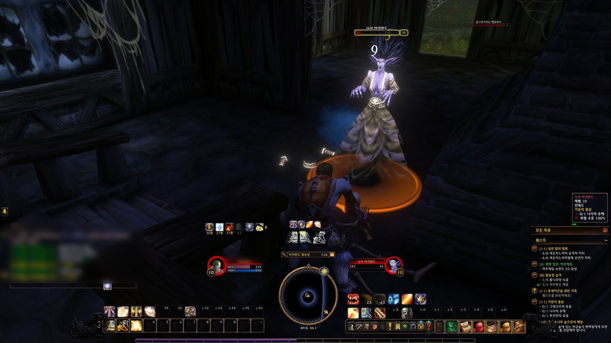

# 검성UI (Kumsung UI)



WoW Forever(게임 1.60.1, 인터페이스 16001)에서 쓰는 오픈소스 UI 애드온입니다.

기본 UI가 좀 밋밋해서 만들었습니다. 유닛 프레임과 단축바를 어둡게 다시 칠하고, 내 체력바와 대상 체력바는 직업색으로 바꾸고,
단축바에는 쿨다운 숫자를 띄웁니다. 화면 배치는 파티·공격대만 위에 두고 나머지는 전부 아래로 모읍니다.

파티·공격대·주시·우두머리 프레임은 블리자드 것을 그대로 씁니다. 색과 위치만 손대기 때문에 인던이나 레이드의
전투 제한에 걸려도 문제없이 돌아갑니다.

## 기능

전부 설정에서 하나씩 켜고 끌 수 있습니다.

- **사거리 표시:** 대상이 사거리 밖이면 단축 버튼이 빨개집니다. 마나가 모자랄 때 뜨는 파란색은 그대로 둡니다.
- **체력 %:** 체력·마나바 숫자 옆에 퍼센트가 같이 나옵니다.
- **위협 수치:** 대상 프레임에 위협 수치가 뜹니다. 탱킹 중이면 2등과 얼마나 차이 나는지 보여줍니다.
- **차단 보조:** 대상 프레임 바로 옆에 내 차단 스킬 아이콘과 쿨다운이 뜨고, 그 옆으로 대상 시전바가 옵니다. 대상이 끊을 수 있는 주문을 시전하면 아이콘 테두리가 노랗게 켜집니다. 차단 스킬은 단축바에 올려둔 것 중에서 게임이 차단기로 표시한 것을 알아서 찾습니다.
- **해제 가능한 디버프만:** 공격대 프레임에는 내가 지울 수 있는 디버프만 보여줍니다.
- **쿨다운 관리자:** 블리자드 쿨다운 관리자를 켜서 직업·전문화별 주요 쿨다운과 버프를 띄웁니다. 레벨이 올라 새 스킬을 배우면 알아서 추가됩니다.
- **단축바 흐리게:** 전투 중도 아니고 대상도 없으면 단축바가 흐려집니다. 얼마나 흐려질지는 정할 수 있습니다.
- **잡템 판매·자동 수리:** 상인 창을 열면 회색 템은 팔고 장비는 내 돈으로 수리합니다.
- **준비 확인 버프 체크:** 준비 확인이 뜨면 파티에 있는 사제·드루이드·마법사 버프 중 빠진 것을 채팅으로 알려줍니다.
- **장비 추천:** 가방에 지금 입은 것보다 좋은 템이 생기면 채팅으로 알려줍니다. 캐릭터 창 아래 `추천 장비 착용` 버튼을 누르면 바로 입습니다.
  점수는 전문화 역할(탱커, 힐러, 근접, 캐스터)에 맞춘 대략적인 능력치 가중치로 매깁니다. 방어구, 목걸이, 망토, 반지만 비교하고,
  무기·방패·장신구와 아직 귀속되지 않은 템은 직접 고르도록 남겨둡니다. 같은 반지를 두 개 추천하지는 않습니다.
  `/ksui stats`를 치면 입은 장비마다 점수와, 점수에 들어가지 않는 능력치 이름을 채팅으로 보여줍니다.
- **채집 추적:** 배운 채집 기술에 맞춰 미니맵의 약초·광석·물고기 추적을 켭니다.

## 설정

`/ksui`를 치거나 설정 > 애드온 > 검성UI로 들어가면 됩니다. 색, 기능 켜고 끄기, 숫자 크기, 프레임 위치를 바꿀 수 있습니다.
외형과 쿨다운 관련 설정은 바꾸는 즉시 적용됩니다.

## 화면 배치

설정에서 `적용`을 누르거나 `/ksui layout`을 치면 배치가 바뀝니다. 전투 중에는 할 수 없습니다.
지금 쓰는 편집 모드 레이아웃을 `KSUI`라는 이름으로 복사해서 옮긴 다음 UI를 다시 불러옵니다.

- **가운데 아래:** 경험치바, 그 위에 미니맵, 그 위에 시전바, 맨 위에 쿨다운 관리자.
- **미니맵 왼쪽:** 주 단축바, 단축바 2, 오른쪽 단축바 1(가로로 눕힘), 태세바.
- **미니맵 오른쪽:** 게임 메뉴와 가방, 단축바 3, 오른쪽 단축바 2(가로로 눕힘), 소환수바. 빈 칸은 숨깁니다.
- **내 프레임 위:** 버프와 디버프. 채팅창은 유닛 프레임 높이까지 올립니다.
- **오른쪽 아래:** 퀘스트 목록. 툴팁은 그 위, 우두머리 프레임은 그 왼쪽 위.
- **미니맵 오른쪽 단축바 위 끝:** 장비 내구도 그림과 수리 경고.
- **왼쪽 위:** 파티와 공격대. 공격대는 40인 기준이라 8개 파티를 옆으로 나란히 두고 칸은 가장 작게 맞춥니다.

다시 적용하면 `KSUI` 레이아웃을 새로 만듭니다. 세세한 위치는 그다음에 편집 모드에서 다듬으면 됩니다.

## 설치 (윈도우)

1. `World of Warcraft\_forever_\Interface\AddOns`에 예전 `KSUI`나 `KSCooldownText` 폴더가 있으면 지웁니다.
2. `kumsung-ui-0.9.1.zip`을 그 폴더에 풉니다. `AddOns\KSUI\KSUI.toc`가 보이면 제대로 된 것입니다.
3. 게임을 껐다 켭니다.

애드온 폴더 이름과 명령어는 `KSUI`(Kumsung UI의 줄임말)를 씁니다. 설정은 `KSUIDB`에 저장됩니다.

## 개발

테스트는 이렇게 돌립니다.

```sh
luajit tests/run.lua
```

버그나 아이디어가 있으면 이슈로 편하게 남겨주세요.

## 라이선스

GNU GPL v3 이상(GPL-3.0-or-later)입니다. 전문은 [LICENSE](LICENSE)에 있습니다.
